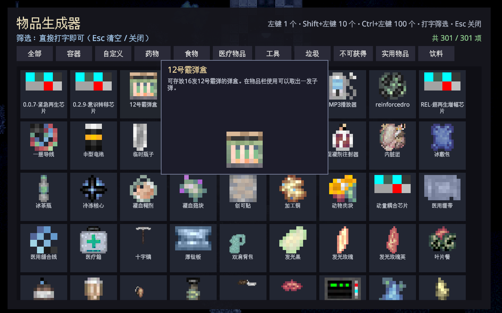

# Item Picker — 物品生成器（Casualties: Unknown）

一个 BepInEx 5 插件：用图标网格浏览并直接生成游戏内的物品，**不走控制台命令，所以不会禁用成就**。

> A BepInEx 5 plugin for *Casualties: Unknown*: browse every spawnable item as an icon grid
> and spawn it directly — **no console commands, so achievements are not disabled**.



## 功能 / Features

- 图标网格列出全部可生成物品（原版 301 项），带分类标签页
- **支持 CUCoreLib mod 物品**：自动读取 mod 注册的物品、图标与说明，新增「mod物品」分类
- 点「mod物品」后才会出现第二行「来源」，可再按具体 mod 过滤（如 Realistic Cardiac / Respiration / Neurology）
- 鼠标悬停显示名称、完整说明与物品大图（自绘提示框，跟随鼠标）
- 左键生成 1 个；`Shift`+左键生成 10 个；`Ctrl`+左键生成 100 个
- 直接打字筛选：中文名 / 拼音全拼（`xindiantu`）/ 拼音首字母（`xdt`）/ 英文 ID
- 菜单打开时临时屏蔽角色操作，关闭后恢复
- 生成位置为角色脚下，2 格内自动拾取（背包满则掉在地上）
- 成就安全：物品直接实例化，不经过 `ConsoleScript.CheckForCheats`

## 安装 / Installation

1. 安装 [BepInEx 5.4.23.4 (x64)](https://github.com/BepInEx/BepInEx/releases) 到游戏根目录（含 `CasualtiesUnknown.exe` 的那层）。
2. 把 `ItemPicker.dll` 放进 `BepInEx/plugins/`。
3. 启动游戏，按 **F8** 打开菜单。

## 使用 / Usage

| 操作 | 效果 |
|---|---|
| `F8` | 打开 / 关闭菜单 |
| 悬停图标 | 显示名称 / 说明 / 大图 |
| 左键 | 生成 1 个 |
| `Shift` + 左键 | 生成 10 个 |
| `Ctrl` + 左键 | 生成 100 个 |
| 打字 | 按名称或 ID 筛选 |
| `Esc` | 清空筛选 → 再按关闭 |

配置文件：`BepInEx/config/qol.itempicker.cfg`

```ini
[General]
## 开关按键（Unity KeyCode 名称，例如 F8 / F9 / Insert）
ToggleKey = F8
## 进图后自动打开菜单的延迟秒数（0 = 关闭）
AutoOpenSeconds = 0
```

## 从源码构建 / Build from source

需要 Windows 自带的 .NET Framework 编译器（`C:\Windows\Microsoft.NET\Framework64\v4.0.30319\csc.exe`），
无需 .NET SDK，也无需 Visual Studio。

```powershell
./build.ps1 -GameDir "C:\Program Files (x86)\Steam\steamapps\common\Casualties Unknown" -Out ".\ItemPicker.dll"
```

`-GameDir` 用来引用游戏自带的 `Assembly-CSharp.dll`、`UnityEngine.*.dll`、`Unity.TextMeshPro.dll`
以及 `BepInEx/core` 下的 `BepInEx.dll`、`0Harmony.dll`。

> 注意：`UnityEngine.CoreModule.dll` 等是 netstandard 2.1 目标，编译时必须额外引用游戏
> `CasualtiesUnknown_Data\Managed\netstandard.dll`，否则会报 CS0012。脚本里已处理。

## 病毒检测 / VirusTotal

[](https://www.virustotal.com/gui/file/71d07017e7868a5cdb230bf5c8d976059f7e8a8637b74cfc51fae12217c6627b)

发布包 `ItemPicker-v1.0.4.zip` 已上传 VirusTotal：**66 个引擎，0 个检出恶意 / 0 个可疑**。

- 报告：https://www.virustotal.com/gui/file/71d07017e7868a5cdb230bf5c8d976059f7e8a8637b74cfc51fae12217c6627b
- SHA256：`71D07017E7868A5CDB230BF5C8D976059F7E8A8637B74CFC51FAE12217C6627B`

> BepInEx 插件本质是往游戏进程里注入 .NET 代码，个别启发式引擎可能因「注入/加载器」行为给出误报；
> 如果你遇到这种情况，可以用上面的 SHA256 在 VirusTotal 上复核，或直接对照 `src/ItemPicker.cs` 自编译。

## 已知限制 / Known limitations

- 多人游戏：只在本地生成，主机与其他玩家看不到。
- 只包含带 `Item` 组件的预制体；建筑 / 实体不在列表内。
- mod 物品需要装 **CUCoreLib**（以及对应 mod）；没有 CUCoreLib 时只显示原版物品。
- 游戏更新后若物品预制体改动，列表会自动跟随（运行时遍历 `Resources`），一般无需重新编译。

## 许可 / License

MIT，见 [LICENSE](LICENSE)。与游戏开发商及 QoL: Unknown 的作者均无隶属关系。
物品名称与图标归游戏版权方所有。

## 发布流程 / Release workflow

编译必须在有游戏本体的机器上做（要引用游戏自带的 `Assembly-CSharp.dll`、`UnityEngine.*`、`Unity.TextMeshPro`
这些**不能公开分发**的程序集），所以流程是「本地编译 + CI 打包发布」：

```powershell
$env:GH_TOKEN = 'github_pat_...'      # Contents: R/W（+ 首次改 workflow 需要 Workflows: R/W）
./release.ps1 -Version 1.0.4 -Notes "修复 xxx"
```

`release.ps1` 会：改版本号（插件 + 说明）→ 本地编译 `dist/ItemPicker.dll` → 通过 API 提交到 `main`
→ 创建 tag `v1.0.4`。tag 推上去后 `.github/workflows/release.yml` 自动：

1. 校验 `src/ItemPicker.cs`、`dist/ItemPicker.dll`、`说明.txt`
2. 打成 `ItemPicker-<tag>.zip`（内含 `BepInEx/plugins/ItemPicker.dll` + 说明）
3. 创建/更新对应 tag 的 GitHub Release 并上传 zip

只想本地构建、不发布：`./release.ps1 -Version 1.0.4 -NoPush`

手打 tag 也一样能触发：`git tag v1.0.4 && git push origin v1.0.4`。